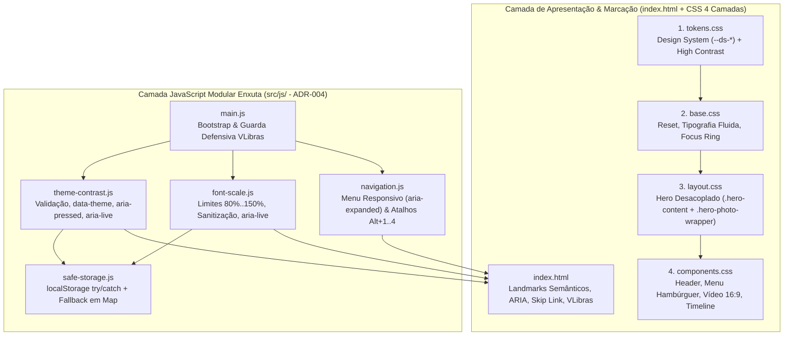
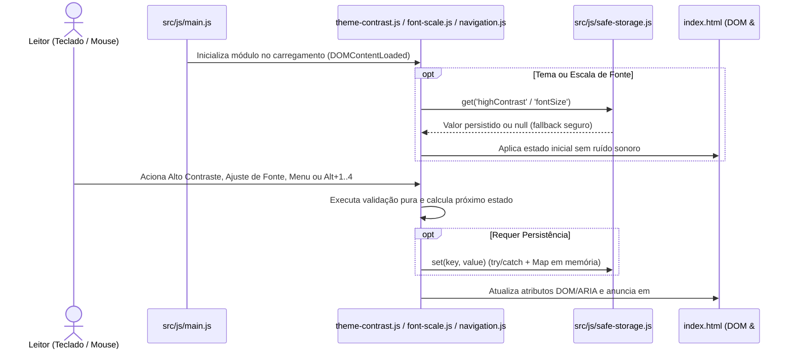

# Visão Geral da Arquitetura — Arquitetura Modular Enxuta (`ADR-004`) & CSS em 4 Camadas (`ADR-001`)

## 1. Princípios Arquiteturais e Solution Design
A arquitetura do projeto `yvonne-mascarenhas` aplica **Spec-Driven Development (SDD)** e **Arquitetura Web Enxuta Orientada a Features** (`ADR-004`) a uma página editorial e biográfica estática. O objetivo de Solution Design é combinar **simplicidade intencional (zero over-engineering)** com 100% de acessibilidade **WCAG 2.2 AA/AAA**, resiliência de persistência e testabilidade determinística em Node.js (`node --test`).

1. **Proporcionalidade e Coesão por Feature (`ADR-004`)**: Em vez de fragmentar uma página estática em múltiplas subpastas de indireção, o JavaScript está organizado em **5 módulos ES6 nativos e coesos** em `src/js/`.
2. **Funções Puras Exportadas + Injeção Opcional**: Cada módulo de feature (`theme-contrast.js`, `font-scale.js`, `navigation.js`) exporta suas funções puras de validação/cálculo e sua função de inicialização com injeção opcional (`{ doc, win, storage }`), permitindo testes unitários e de integração rápidos sem navegador headless.
3. **Resiliência de Armazenamento (`safe-storage.js`)**: Encapsula `window.localStorage` (`get`, `set`, `remove`) em blocos `try/catch` com fallback silencioso em `Map` na memória quando o navegador bloqueia o storage.
4. **Arquitetura CSS em 4 Camadas (`ADR-001`)**: Separação determinística por especificidade e propósito (`tokens.css` → `base.css` → `layout.css` → `components.css`).

---

## 2. Estrutura de Diretórios e Stack Técnica

- **Stack Técnica**: HTML5 Semântico (WAI-ARIA), CSS3 Nativo em 4 Camadas (Custom Properties, Grid, Flexbox), JavaScript ES6+ Nativos (Modules) e Node.js Test Runner (`node:test` + `node:assert/strict`). Zero dependências externas de runtime.

```text
yvonne-mascarenhas/
├── index.html                        # Marcação semântica, landmarks ARIA, skip-link e VLibras
├── package.json                      # Scripts de teste (npm test) e validação SDD (npm run verify)
├── scripts/
│   └── validate-sdd.mjs              # Gate determinístico de validação de artefatos SDD e Proofs
├── src/
│   ├── assets/
│   │   └── yvonne.png                # Retrato editorial da Dra. Yvonne Mascarenhas
│   ├── css/
│   │   ├── tokens.css                # 1. Tokens primitivos (--ds-*) e semânticos (:root e high-contrast)
│   │   ├── base.css                  # 2. Reset, tipografia fluida, focus-visible e reduced-motion
│   │   ├── layout.css                # 3. Grid editorial 2 colunas no Hero e fluxo de leitura
│   │   └── components.css            # 4. Barra de topo, menu responsivo, vídeos 16:9 e timeline
│   └── js/
│       ├── safe-storage.js           # Helper resiliente p/ localStorage com fallback em Map
│       ├── theme-contrast.js         # Tema Alto Contraste (data-theme, aria-pressed, aria-live)
│       ├── font-scale.js             # Escala tipográfica (80%..150%, sanitização, aria-live)
│       ├── navigation.js             # Menu responsivo (aria-expanded) e atalhos Alt+1..4
│       └── main.js                   # Bootstrap único dos módulos e guarda defensiva VLibras
├── tests/
│   ├── accessibility-and-dom.test.js # Auditoria estrutural HTML/CSS e contraste matemático WCAG 2.2
│   ├── theme-contrast.test.js        # Testes unitários e de integração de Alto Contraste e safeStorage
│   ├── font-scale.test.js            # Testes unitários e de integração de escala de fonte
│   └── navigation.test.js            # Testes unitários e de integração de menu, atalhos e bootstrap
└── .specs/                           # Artefatos Spec-Driven Development (STATE.md, ADRs, features, project)
```

---

## 3. Diagrama da Arquitetura Modular Enxuta (`src/js/` + `src/css/`)



---

## 4. Fluxo de Interação (Sequence Diagram)


