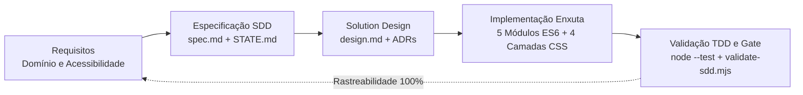
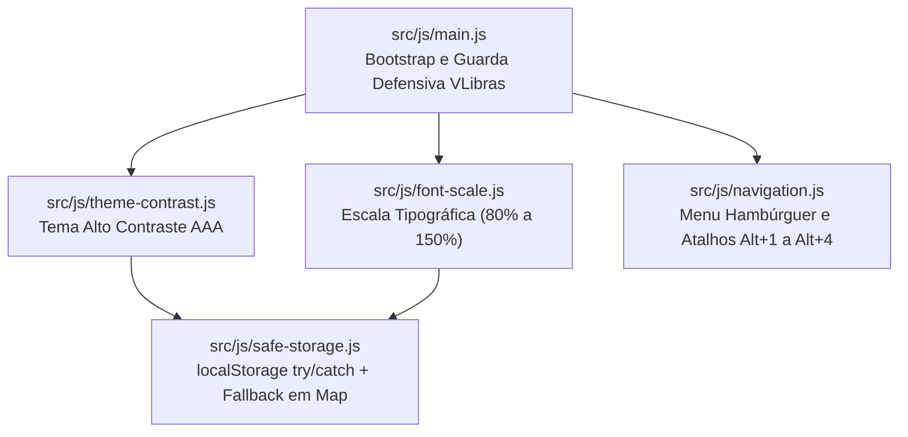

<div align="center">

# Yvonne Mascarenhas — Homenagem Científica e Engenharia Acessível

### Spec-Driven Development (SDD) · Arquitetura Modular Enxuta · Test-Driven Development (TDD) · Acessibilidade WCAG 2.2 AA/AAA

[](https://julianachavespalm.github.io/yvonne-mascarenhas/)
[](#arquitetura-enxuta-e-decisoes-de-design)
[](#engenharia-de-acessibilidade-e-design-system)

</div>

---

## Visão Geral

Aplicação web desenvolvida em homenagem à **Dra. Yvonne Primerano Mascarenhas**, pioneira da cristalografia estrutural por difração de raios-X no Brasil, Professora Emérita da Universidade de São Paulo (USP) / Conselho Nacional de Desenvolvimento Científico e Tecnológico (CNPq) e Membro Titular da Academia Brasileira de Ciências (ABC).

> **Acesso Online:** [https://julianachavespalm.github.io/yvonne-mascarenhas/](https://julianachavespalm.github.io/yvonne-mascarenhas/)

O projeto aplica **Spec-Driven Development (SDD)** e **Solution Design enxuto** — desde a especificação formal de histórias de usuário (**Como / Eu quero / Para que**) e critérios no formato **Dado / Quando / Então** até a validação automatizada por meio de **Test-Driven Development (TDD)** — estruturado sobre uma arquitetura front-end estática sem dependências externas de tempo de execução:

| Dimensão | Abordagem Técnica | Rastreabilidade no Repositório |
|---|---|---|
| **Especificação (SDD)** | Histórias de usuário, critérios **Dado / Quando / Então**, Architecture Decision Records (ADRs) e matriz de cobertura validada por gate determinístico | [`.specs/STATE.md`](.specs/STATE.md) · [`.specs/features/`](.specs/features/) · [`scripts/validate-sdd.mjs`](scripts/validate-sdd.mjs) |
| **Arquitetura Modular Enxuta (`ADR-004`)** | 5 módulos ECMAScript 2015 (ES6) nativos organizados por funcionalidade em `src/js/`, separando regras puras de negócio da manipulação do Document Object Model (DOM) via injeção de dependência. | [`src/js/safe-storage.js`](src/js/safe-storage.js) · [`src/js/theme-contrast.js`](src/js/theme-contrast.js) · [`src/js/font-scale.js`](src/js/font-scale.js) · [`src/js/navigation.js`](src/js/navigation.js) · [`src/js/main.js`](src/js/main.js) |
| **Validação Orientada a Features (TDD)** | Testes unitários, de integração e auditoria matemática de luminância World Wide Web Consortium (W3C) utilizando `node --test` | [`tests/theme-contrast.test.js`](tests/theme-contrast.test.js) · [`tests/font-scale.test.js`](tests/font-scale.test.js) · [`tests/navigation.test.js`](tests/navigation.test.js) · [`tests/accessibility-and-dom.test.js`](tests/accessibility-and-dom.test.js) |

---

## Fluxo SDD (Spec-Driven Development)



---

## Estrutura de Diretórios

```text
yvonne-mascarenhas/
├── .github/
│   └── workflows/
│       └── ci.yml                    # Pipeline de Continuous Integration / Continuous Delivery (CI/CD)
├── index.html                        # Marcação semântica em HTML5, landmarks WAI-ARIA, skip-link e VLibras
├── package.json                      # Metadados do projeto e scripts de teste e verificação SDD
├── scripts/
│   └── validate-sdd.mjs              # Validador determinístico das especificações e provas de teste
├── src/
│   ├── assets/
│   │   └── yvonne.png                # Retrato editorial oficial da Dra. Yvonne Mascarenhas
│   ├── css/
│   │   ├── tokens.css                # 1. Tokens do Design System (:root e [data-theme="high-contrast"])
│   │   ├── base.css                  # 2. Reset, tipografia fluida, focus-visible e prefers-reduced-motion
│   │   ├── layout.css                # 3. Grid editorial de 2 colunas no topo e fluxo principal
│   │   └── components.css            # 4. Barra de topo, menu responsivo, vídeos 16:9 e linha do tempo
│   └── js/
│       ├── safe-storage.js           # Persistência resiliente em window.localStorage com fallback em Map
│       ├── theme-contrast.js         # Controle de Alto Contraste AAA, aria-pressed e anúncios em aria-live
│       ├── font-scale.js             # Limites de escala tipográfica (80% a 150%), sanitização e persistência
│       ├── navigation.js             # Menu responsivo (aria-expanded) e atalhos globais de teclado Alt+1 a Alt+4
│       └── main.js                   # Ponto de entrada com bootstrap único dos módulos e guarda do VLibras
├── tests/
│   ├── accessibility-and-dom.test.js # Testes de DOM, conformidade das 4 camadas CSS, WCAG 2.2 e VLibras
│   ├── theme-contrast.test.js        # Testes de unidade e integração do tema de contraste e safe-storage.js
│   ├── font-scale.test.js            # Testes de unidade e integração dos limites de escala de fonte
│   └── navigation.test.js            # Testes de unidade e integração de atalhos, menu e bootstrapApp
└── .specs/
    ├── STATE.md                      # Estado global, decisões arquiteturais (AD-001 a AD-006) e matriz
    ├── decisions/                    # Registros formais de Architecture Decision Records (ADR-001 a ADR-006)
    ├── project/                      # Visão executiva, arquitetura, glossário, qualidade e style guide
    └── features/                     # Especificações detalhadas por feature (spec.md, design.md, tasks.md)
```

---

## Arquitetura Enxuta e Decisões de Design

### 1. Camada JavaScript em 5 Módulos Nativos (`src/js/` — [`ADR-004`](.specs/decisions/ADR-004-lean-modular-architecture.md))

Guiada pela proporcionalidade de Solution Design para aplicações editoriais estáticas, a camada de comportamento é organizada em 5 módulos ECMAScript 2015 (ES6) nativos com zero dependências de tempo de execução, separando funções puras (regras de cálculo e sanitização) da manipulação do Document Object Model (DOM).



### 2. Arquitetura Cascading Style Sheets (CSS) em 4 Camadas (`src/css/` — [`ADR-001`](.specs/decisions/ADR-001-css-layers.md))

A hierarquia de estilos adota o princípio de especificidade crescente e separação estrita de responsabilidades:

- **[`tokens.css`](src/css/tokens.css)**: Tokens semânticos para o tema padrão (`#0b0e14`, `#ffffff`, `#9ba1a6`, `#e63946`) e para `[data-theme="high-contrast"]` (`#000000`, `#ffffff`, `#ffff00`, `#00ffff`).
- **[`base.css`](src/css/base.css)**: Reset, tipografia fluida, anel de foco acessível (`:focus-visible`), classes utilitárias de acessibilidade (`.skip-link`, `.sr-only`) e desativação de transições sob `@media (prefers-reduced-motion: reduce)`.
- **[`layout.css`](src/css/layout.css)**: Topo editorial em grid de 2 colunas (`.hero-intro-grid`) separando o bloco tipográfico (`.hero-content`) do container isolado da fotografia (`.hero-photo-wrapper`) ([`ADR-003`](.specs/decisions/ADR-003-hero-editorial.md)), mantendo a imagem visível com borda branca no tema de Alto Contraste.
- **[`components.css`](src/css/components.css)**: Barra superior com navegação responsiva em linha única ou menu hambúrguer, botões interativos de acessibilidade, molduras de vídeo em proporção 16:9 e linha do tempo cronológica com marcadores em CSS puro.

---

## Engenharia de Acessibilidade e Design System

Os pares cromáticos do Design System ([`FEAT-009-Design-System`](.specs/features/FEAT-009-Design-System/spec.md)) são verificados matematicamente na suíte automatizada de testes pela fórmula de luminância relativa da World Wide Web Consortium (W3C), expressa por $CR = (L_1 + 0.05) / (L_2 + 0.05)$, onde $L_1$ representa a luminância da cor mais clara e $L_2$ a da cor mais escura:

| Contexto Semântico | Par de Cores Hexadecimal | Razão de Contraste ($CR$) | Conformidade WCAG 2.2 |
|---|---|---|---|
| **Títulos e Texto Principal** | `#ffffff` sobre `#0b0e14` (`--bg`) | **`19.16 : 1`** | **AAA** (Mínimo exigido em AA: 4.5:1) |
| **Texto Secundário e Metadados** | `#9ba1a6` sobre `#0b0e14` (`--bg`) | **`7.32 : 1`** | **AAA** (Mínimo exigido em AA: 4.5:1) |
| **Acentos Tipográficos (`--accent-red`)** | `#e63946` sobre `#0b0e14` (`--bg`) | **`4.59 : 1`** | **AA** (Mínimo exigido em AA: 4.5:1) |
| **Alto Contraste (Texto, Ativo e `:hover`)** | `#ffffff` / `#ffff00` / `#00ffff` sobre `#000000` | **`21.0:1` · `19.56:1` · `16.75:1`** | **AAA Estrito** |

---

## Auditoria de Cobertura por Feature (Matriz de Rastreabilidade)

Todas as 9 especificações formais do projeto encontram-se implementadas no código-fonte e auditadas por testes determinísticos:

| Feature | Escopo e Regras de Negócio | Implementação | Prova Automatizada | Status |
| :--- | :--- | :--- | :--- | :---: |
| **FEAT-001**<br/>Hero Editorial | Bloco `.hero-content` desacoplado de `.hero-photo-wrapper`; retrato oficial sem texto sobre o rosto; preservação da imagem no modo Alto Contraste com borda branca. | `index.html`<br/>`src/css/layout.css` | `tests/accessibility-and-dom.test.js` | Verified |
| **FEAT-002**<br/>Navegação e Atalhos | Skip link `#conteudo` como primeiro elemento focável; menu hambúrguer responsivo com controle de `aria-expanded`; atalhos globais de teclado `Alt+1` a `Alt+4`. | `index.html`<br/>`src/js/navigation.js` | `tests/navigation.test.js`<br/>`tests/accessibility-and-dom.test.js` | Verified |
| **FEAT-003**<br/>Escala de Fonte | Limites estritos de 80% a 150% em passos de 10%; sanitização de entradas corrompidas; feedback por voz em container com `aria-live="polite"`. | `src/js/font-scale.js`<br/>`src/js/safe-storage.js` | `tests/font-scale.test.js` | Verified |
| **FEAT-004**<br/>Modo de Alto Contraste | Alternância determinística do atributo `data-theme="high-contrast"`; sincronização de `aria-pressed`; fallback silencioso em `Map` na memória em caso de restrição de armazenamento. | `src/js/theme-contrast.js`<br/>`src/js/safe-storage.js` | `tests/theme-contrast.test.js` | Verified |
| **FEAT-005**<br/>Conteúdo Editorial | Seções semânticas vinculadas por `aria-labelledby`; destaque tipográfico `.crimson-callout`; links externos com proteção `rel="noopener noreferrer"`. | `index.html`<br/>`src/css/components.css` | `tests/accessibility-and-dom.test.js` | Verified |
| **FEAT-006**<br/>Vídeos Responsivos | Iframes com `loading="lazy"` e títulos acessíveis Accessible Rich Internet Applications (ARIA); container com proporção nativa `aspect-ratio: 16 / 9`; legendas em `<figcaption>`. | `index.html`<br/>`src/css/components.css` | `tests/accessibility-and-dom.test.js` | Verified |
| **FEAT-007**<br/>Linha do Tempo de Prêmios | 8 marcos cronológicos decrescentes (2021 a 1998); marcação temporal semântica via elemento `<time datetime="...">`; conectores visuais em CSS nativo. | `index.html`<br/>`src/css/components.css` | `tests/accessibility-and-dom.test.js` | Verified |
| **FEAT-008**<br/>Integração VLibras | Marcação oficial do avatar no fechamento do `<body>`; guarda defensiva contra indisponibilidade de rede de terceiros; inicialização não-bloqueante. | `index.html`<br/>`src/js/main.js` | `tests/accessibility-and-dom.test.js` | Verified |
| **FEAT-009**<br/>Design System e Tokens | Conformidade matemática com os critérios de sucesso da WCAG 2.2; estados de `:hover` em alto contraste com fundo `#ffff00` e texto `#000000`; ausência de bordas invasivas em textos. | `src/css/tokens.css`<br/>`src/css/base.css` | `tests/accessibility-and-dom.test.js` | Verified |

---

## Como Executar e Visualizar Localmente

- **Visualização Imediata (Produção):** Acesse diretamente pelo navegador em [https://julianachavespalm.github.io/yvonne-mascarenhas/](https://julianachavespalm.github.io/yvonne-mascarenhas/).

### 1. Visualizar a Aplicação no Navegador (Servidor Local)

Por utilizar módulos nativos ECMAScript 2015 (ES6) carregados via `<script type="module">`, a aplicação deve ser servida através de um servidor local sob o protocolo Hypertext Transfer Protocol (HTTP) para evitar restrições de segurança do mecanismo de Cross-Origin Resource Sharing (CORS) aplicadas pelos navegadores modernos a arquivos abertos diretamente pelo protocolo `file://`.

Execute qualquer um dos comandos abaixo na raiz do repositório (sem necessidade de instalação prévia de pacotes globais):

```bash
# Opção A: Utilizando Node.js (via npx serve)
npx serve . -l 8080

# Opção B: Utilizando Python 3
python -m http.server 8080
```

Após iniciar o servidor local, abra o navegador e acesse o endereço:

```text
http://localhost:8080
```

### 2. Executar Validações Automatizadas (Quality Gate)

O repositório conta com uma esteira determinística de validação que audita tanto a governança das especificações Spec-Driven Development (SDD) quanto o funcionamento do código através de testes automatizados:

```bash
# Executar a suíte de testes unitários, estruturais e auditoria matemática de contraste
npm test

# Executar a auditoria de conformidade das especificações SDD (spec.md, design.md, tasks.md, STATE.md e ADRs)
npm run validate:specs

# Executar o Quality Gate completo em comando único
npm run verify
```

O projeto também mantém um pipeline de Continuous Integration / Continuous Delivery (CI/CD) configurado em [`.github/workflows/ci.yml`](.github/workflows/ci.yml), que executa essas mesmas validações a cada envio (*push*) ou solicitação de integração (*pull request*) direcionada para a ramificação (*branch*) `main`.

---

## Catálogo de Especificações (`.specs/`)

<table>
<tr>
<td valign="top" width="50%">

### Arquitetura e Decisões
- [**STATE.md — Memória e Decisões (`AD-001` a `AD-006`)**](.specs/STATE.md)
- [**Visão Executiva (`vision.md`)**](.specs/project/vision.md)
- [**Visão Arquitetural (`architecture-overview.md`)**](.specs/project/architecture-overview.md)
- [**Atributos de Qualidade e Indicadores de Nível de Serviço (`quality-attributes.md`)**](.specs/project/quality-attributes.md)
- [**Guia do Design System (`style-guide.md`)**](.specs/project/style-guide.md)
- [**Architecture Decision Records Detalhadas (`ADR-001` a `ADR-006`)**](.specs/decisions/)

</td>
<td valign="top" width="50%">

### Features Especificadas (`spec.md`, `design.md`, `tasks.md`)
- [**FEAT-001 · Hero Editorial**](.specs/features/FEAT-001-Hero-Editorial/spec.md)
- [**FEAT-002 · Navegação Semântica, Menu e Atalhos**](.specs/features/FEAT-002-Navigation/spec.md)
- [**FEAT-003 · Redimensionamento e Escala de Fonte**](.specs/features/FEAT-003-Font-Control/spec.md)
- [**FEAT-004 · Tema de Alto Contraste AAA**](.specs/features/FEAT-004-High-Contrast/spec.md)
- [**FEAT-005 · Conteúdo Editorial Semântico**](.specs/features/FEAT-005-Editorial-Content/spec.md)
- [**FEAT-006 · Experiência de Vídeo Lazy-Loaded**](.specs/features/FEAT-006-Video-Experience/spec.md)
- [**FEAT-007 · Linha do Tempo de Prêmios**](.specs/features/FEAT-007-Awards-Timeline/spec.md)
- [**FEAT-008 · Integração Resiliente VLibras**](.specs/features/FEAT-008-VLibras-Integration/spec.md)
- [**FEAT-009 · Design System e Tokens WCAG**](.specs/features/FEAT-009-Design-System/spec.md)

</td>
</tr>
</table>

---

## Autoria e Engenharia

Projeto concebido, arquitetado e desenvolvido por:

**Juliana Chaves Palm**  
*Software Engineer · Solution Design & Spec-Driven Development · Sistemas Escaláveis e Acessibilidade*  

- GitHub: [https://github.com/julianachavespalm](https://github.com/julianachavespalm)  
- LinkedIn: [https://linkedin.com/in/julianachavespalm](https://linkedin.com/in/julianachavespalm)  
