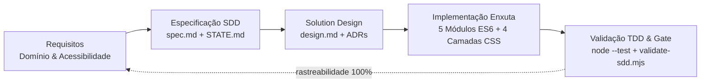
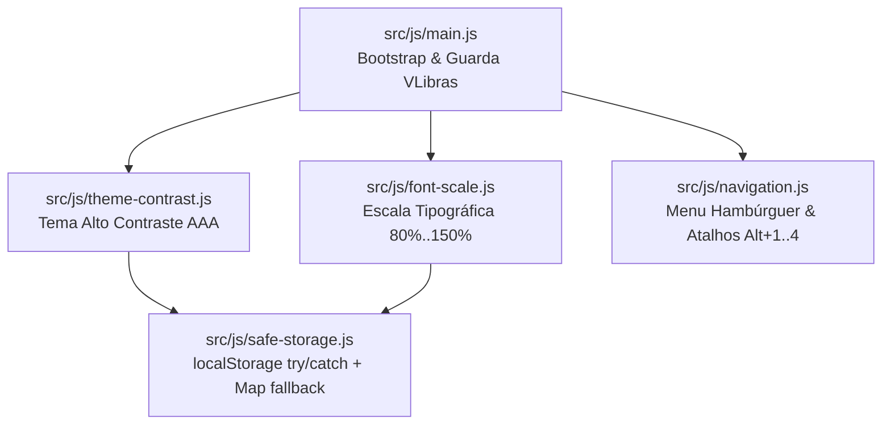

<div align="center">

# Yvonne Mascarenhas — Homenagem Científica & Engenharia Acessível

### Spec-Driven Development (SDD) · Arquitetura Modular Enxuta · TDD · Acessibilidade WCAG 2.2 AA/AAA

[](https://julianachavespalm.github.io/yvonne-mascarenhas/)
[](#-arquitetura-enxuta-e-decis%C3%B5es-de-design)
[](#-engenharia-de-acessibilidade-e-design-system)

</div>

---

## 🎯 Visão Geral

Aplicação web em homenagem à **Dra. Yvonne Primerano Mascarenhas**, pioneira da cristalografia estrutural por difração de raios-X no Brasil, Professora Emérita da USP/CNPq e Membro Titular da Academia Brasileira de Ciências (ABC).

O projeto aplica **Spec-Driven Development (SDD)** e **Solution Design enxuto** — da especificação formal de histórias de usuário (**Como / Eu quero / Para que**) e critérios **Dado / Quando / Então** à validação automatizada via **TDD** — sobre uma arquitetura front-end estática sem dependências externas de runtime:

| Dimensão | Abordagem Técnica | Rastreabilidade no Repositório |
|---|---|---|
| **Especificação (SDD)** | Histórias de usuário, critérios **Dado / Quando / Então**, ADRs e matriz de cobertura validada por gate determinístico | [`.specs/STATE.md`](.specs/STATE.md) · [`.specs/features/`](.specs/features/) · [`scripts/validate-sdd.mjs`](scripts/validate-sdd.mjs) |
| **Arquitetura Modular Enxuta (`ADR-004`)** | Simplicidade intencional: 5 módulos ES6 coesos orientados a features em `src/js/`, combinando funções puras exportadas e manipulação de DOM com injeção opcional | [`src/js/safe-storage.js`](src/js/safe-storage.js) · [`src/js/theme-contrast.js`](src/js/theme-contrast.js) · [`src/js/font-scale.js`](src/js/font-scale.js) · [`src/js/navigation.js`](src/js/navigation.js) · [`src/js/main.js`](src/js/main.js) |
| **Validação Orientada a Features (TDD)** | Testes unitários, de integração e auditoria matemática de luminância W3C usando `node --test` | [`tests/theme-contrast.test.js`](tests/theme-contrast.test.js) · [`tests/font-scale.test.js`](tests/font-scale.test.js) · [`tests/navigation.test.js`](tests/navigation.test.js) · [`tests/accessibility-and-dom.test.js`](tests/accessibility-and-dom.test.js) |

---

## 🧭 Fluxo SDD (Spec-Driven Development)



---

## 📂 Estrutura de Diretórios

```text
yvonne-mascarenhas/
├── index.html                        # Marcação semântica, landmarks ARIA, skip-link e VLibras
├── package.json                      # Scripts de teste e verificação SDD
├── scripts/
│   └── validate-sdd.mjs              # Validador determinístico das especificações e provas de teste
├── src/
│   ├── assets/
│   │   └── yvonne.png                # Retrato editorial da Dra. Yvonne Mascarenhas
│   ├── css/
│   │   ├── tokens.css                # 1. Tokens do Design System (:root e [data-theme="high-contrast"])
│   │   ├── base.css                  # 2. Reset, tipografia fluida, focus-visible e prefers-reduced-motion
│   │   ├── layout.css                # 3. Grid editorial 2 colunas no topo (.hero-intro-grid) e fluxo principal
│   │   └── components.css            # 4. Header, menu hambúrguer, botões A11y, vídeos 16:9 e timeline
│   └── js/
│       ├── safe-storage.js           # Persistência resiliente em localStorage com fallback em Map
│       ├── theme-contrast.js         # Controle de Alto Contraste AAA, aria-pressed e aria-live
│       ├── font-scale.js             # Limites de escala (80%..150%), sanitização e persistência
│       ├── navigation.js             # Menu responsivo (aria-expanded) e atalhos de teclado Alt+1..4
│       └── main.js                   # Bootstrap único dos módulos e guarda defensiva do VLibras
├── tests/
│   ├── accessibility-and-dom.test.js # Testes de DOM, ordem das 4 camadas CSS, WCAG 2.2 e VLibras
│   ├── theme-contrast.test.js        # Testes do módulo theme-contrast.js e safe-storage.js
│   ├── font-scale.test.js            # Testes do módulo font-scale.js
│   └── navigation.test.js            # Testes do módulo navigation.js e bootstrapApp
└── .specs/
    ├── STATE.md                      # Estado global, decisões arquiteturais (AD-001 a AD-006) e mapeamento
    ├── decisions/                    # Registros formais de decisão arquitetural (ADR-001 a ADR-006)
    ├── project/                      # Visão executiva, arquitetura, glossário, atributos de qualidade e style guide
    └── features/                     # Especificações por feature (spec.md, design.md, tasks.md)
```

---

## 🏗️ Arquitetura Enxuta e Decisões de Design

### 1. Camada JavaScript Consolidada em 5 Módulos (`src/js/` — [`ADR-004`](.specs/decisions/ADR-004-lean-modular-architecture.md))

Por proporcionalidade de Solution Design para uma página editorial estática, consolidamos o JavaScript em 5 módulos ES6 nativos altamente coesos:



### 2. Arquitetura CSS em 4 Camadas (`src/css/` — [`ADR-001`](.specs/decisions/ADR-001-css-layers.md))

- **[`tokens.css`](src/css/tokens.css)**: Tokens semânticos para o tema padrão (`#0b0e14`, `#ffffff`, `#9ba1a6`, `#e63946`) e para `[data-theme="high-contrast"]` (`#000000`, `#ffffff`, `#ffff00`, `#00ffff`).
- **[`base.css`](src/css/base.css)**: Reset, tipografia fluida, anel de foco (`:focus-visible`), `.skip-link`, `.sr-only` e suporte a `prefers-reduced-motion`.
- **[`layout.css`](src/css/layout.css)**: Topo em 2 colunas (`.hero-intro-grid`) separando `.hero-content` e `.hero-photo-wrapper` ([`ADR-003`](.specs/decisions/ADR-003-hero-editorial.md)), mantendo a foto visível com borda branca no Alto Contraste.
- **[`components.css`](src/css/components.css)**: Barra superior com navegação em linha única ou menu hambúrguer responsivo, botão de Alto Contraste, cards de vídeo `16:9` e linha do tempo cronológica.

---

## ♿ Engenharia de Acessibilidade e Design System

Os pares de cores do Design System ([`FEAT-009-Design-System`](.specs/features/FEAT-009-Design-System/spec.md)) são verificados matematicamente na suíte de testes pela fórmula de luminância relativa da W3C $CR = (L_1 + 0.05) / (L_2 + 0.05)$:

| Contexto Semântico | Par de Cores | Razão de Contraste ($CR$) | Conformidade WCAG 2.2 |
|---|---|---|---|
| **Títulos e Texto Principal** | `#ffffff` sobre `#0b0e14` (`--bg`) | **`19.16 : 1`** | **AAA** (Mínimo AA: 4.5:1) |
| **Texto Secundário e Metadados** | `#9ba1a6` sobre `#0b0e14` (`--bg`) | **`7.32 : 1`** | **AAA** (Mínimo AA: 4.5:1) |
| **Acentos Tipográficos (`--accent-red`)** | `#e63946` sobre `#0b0e14` (`--bg`) | **`4.59 : 1`** | **AA** (Mínimo AA: 4.5:1) |
| **Alto Contraste (Texto, Ativo e `:hover`)** | `#ffffff` / `#ffff00` / `#00ffff` sobre `#000000` | **`21.0:1` · `19.56:1` · `16.75:1`** | **AAA Estrito** |

---

## 📐 Catálogo de Especificações (`.specs/`)

<table>
<tr>
<td valign="top" width="50%">

### 🏛️ Arquitetura & Decisões
- [**STATE.md — Memória e Decisões (`AD-001`..`AD-006`)**](.specs/STATE.md)
- [**Visão Executiva (`vision.md`)**](.specs/project/vision.md)
- [**Visão Arquitetural (`architecture-overview.md`)**](.specs/project/architecture-overview.md)
- [**Atributos de Qualidade & SLIs (`quality-attributes.md`)**](.specs/project/quality-attributes.md)
- [**Guia do Design System (`style-guide.md`)**](.specs/project/style-guide.md)
- [**ADRs Detalhadas (`ADR-001` a `ADR-006`)**](.specs/decisions/)

</td>
<td valign="top" width="50%">

### 📦 Features Especificadas (`spec.md` + `design.md` + `tasks.md`)
- [**FEAT-001 · Hero Editorial**](.specs/features/FEAT-001-Hero-Editorial/spec.md)
- [**FEAT-002 · Navegação Semântica, Menu & Atalhos**](.specs/features/FEAT-002-Navigation/spec.md)
- [**FEAT-003 · Redimensionamento & Escala de Fonte**](.specs/features/FEAT-003-Font-Control/spec.md)
- [**FEAT-004 · Tema de Alto Contraste AAA**](.specs/features/FEAT-004-High-Contrast/spec.md)
- [**FEAT-005 · Conteúdo Editorial Semântico**](.specs/features/FEAT-005-Editorial-Content/spec.md)
- [**FEAT-006 · Experiência de Vídeo Lazy-Loaded**](.specs/features/FEAT-006-Video-Experience/spec.md)
- [**FEAT-007 · Linha do Tempo de Prêmios**](.specs/features/FEAT-007-Awards-Timeline/spec.md)
- [**FEAT-008 · Integração Resiliente VLibras**](.specs/features/FEAT-008-VLibras-Integration/spec.md)
- [**FEAT-009 · Design System & Tokens WCAG**](.specs/features/FEAT-009-Design-System/spec.md)

</td>
</tr>
</table>

---

## ✅ Verificação e Qualidade

Execute os testes unitários e o validador de especificações SDD com:

```bash
npm test
npm run verify
```

<div align="center">
<sub>Desenvolvido por <strong>Juliana Chaves Palm</strong> · Engenharia de Software orientada por Especificações (SDD), Arquitetura Modular Enxuta e Acessibilidade.</sub>
</div>
